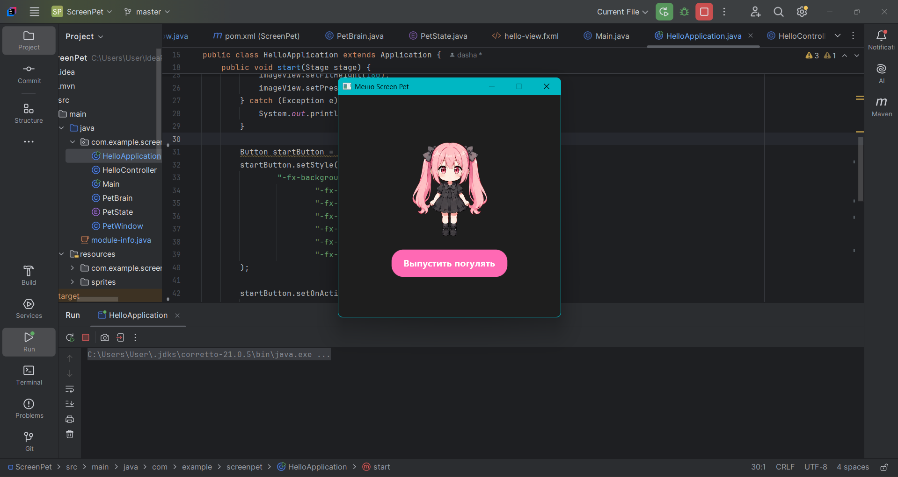
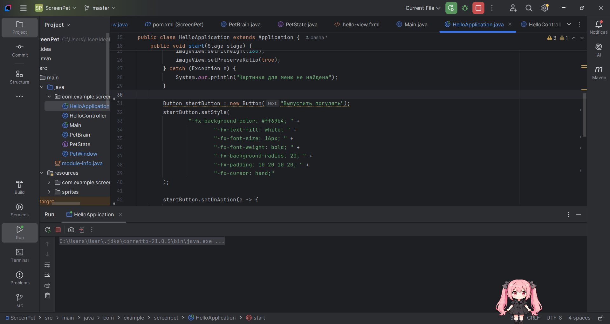
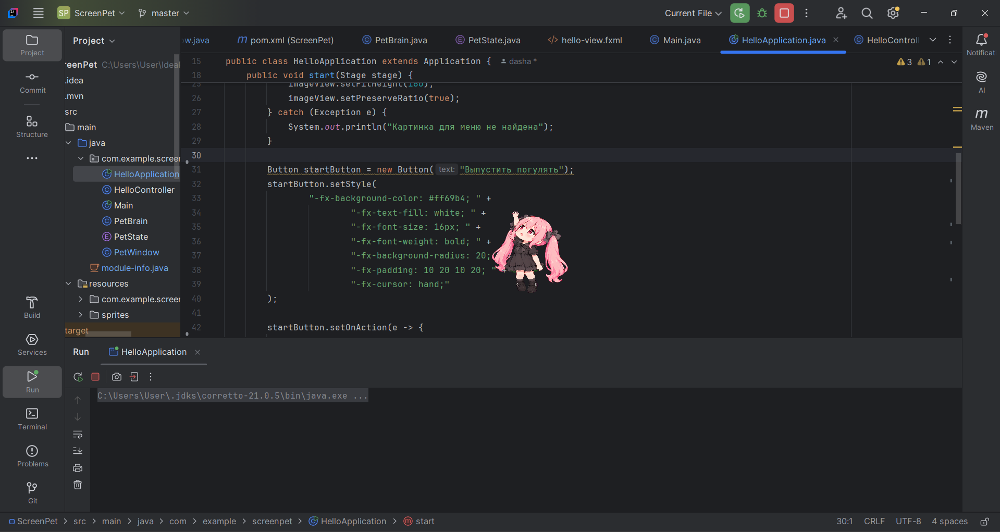
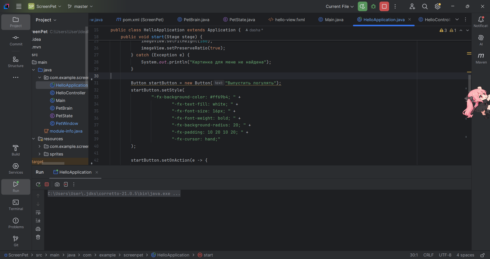
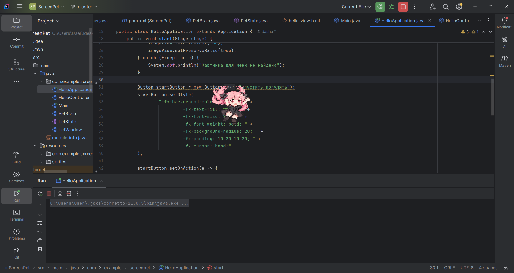

# Screen Pet (Десктопная девочка-компаньон)

**Screen Pet** — это интерактивное приложение на Java, которое добавляет на ваш рабочий стол анимированную девочку. 
Она гуляет по экрану, ползает по стенам, прыгает, реагирует на клики.

## Основные возможности:

- **Прозрачное окно** — девочка отображается без фона и рамок, всегда поверх других окон.
- **Плавная анимация** — ходьба влево и вправо, ползание по стенам, прыжки и падение.
- **Физика** — гравитация, прилипание к стенам, падение с потолка.
- **Перетаскивание** — вы можете взять её мышкой и перенести в любое место (она будет держаться за курсор).
---

## Видео-демонстрация:

https://github.com/user-attachments/assets/287a4ec3-5417-4605-bd64-f104b474323d

---

## Скриншоты:

Вот как выглядит наша девочка в разных состояниях:

  
     
  
    
  
    
  
    
  

## Как запустить:

1. Убедитесь, что у вас установлен **JDK 21** 
2. Откройте проект в **IntelliJ IDEA**.
3. Дождитесь загрузки Maven-зависимостей.
4. Запустите файл `src/main/java/com/example/screenpet/HelloApplication.java`
